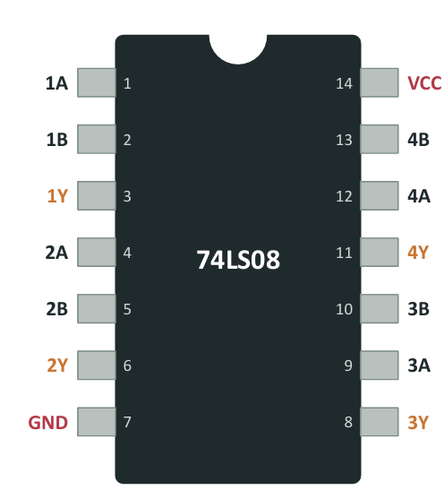

<!-- ===================== ENCABEZADO DE LA SEMANA ===================== -->

  

<blockquote>
  
🎯 <b>Objetivo:</b> Convertir entre decimal/binario/octal/hex, representar negativos en complemento a dos, reconocer BCD, Gray y ASCII, y leer las 7 compuertas en un circuito integrado 74LS. Aporta a <b>R1</b>: diseña e implementa circuitos combinacionales básicos con diseño clásico.

</blockquote>

<h2>🧠 Lo esencial en 5 líneas</h2>
<ol>
  <li>El computador usa <b>dos estados</b> porque un transistor es un interruptor y dos niveles son fáciles de distinguir aun con ruido.</li>
  <li>Un «1» no es un voltaje exacto: es un <b>rango</b>. Entre 0,8 V y 2,0 V (74LS) hay una <b>zona indefinida</b>.</li>
  <li>En todo sistema <b>posicional</b> cada posición vale una potencia de la base.</li>
  <li>Negativo = <b>invertir bits y sumar 1</b> → restar es sumar el negativo (el mismo sumador sirve).</li>
  <li>Con <i>n</i> bits, el resultado debe caber: si no, hay <b>desbordamiento</b>.</li>
</ol>

<h2>⚡ 1. Niveles lógicos (familia 74LS)</h2>

  

<blockquote>
  
⚠️ <b>Falla de ejemplo:</b> Sale un 0 de 0,5 V, un motor induce 0,4 V → llegan 0,9 V → zona indefinida → error.

</blockquote>

<h2>🔢 2. Sistemas numéricos y conversiones</h2>

<table align="center" width="100%">
  <tr>
    <th>Operación</th>
    <th>Método</th>
    <th>Ejemplo</th>
  </tr>
  <tr>
    <td><b>Binario → decimal</b></td>
    <td>Sumar pesos 128 · 64 · 32 · 16 · 8 · 4 · 2 · 1</td>
    <td><code>1011₂ = 8+0+2+1 = 11</code></td>
  </tr>
  <tr>
    <td><b>Decimal → binario</b></td>
    <td>Dividir entre 2 y leer restos <b>de abajo hacia arriba</b></td>
    <td><code>25 = 11001₂</code></td>
  </tr>
  <tr>
    <td><b>Binario → hex</b></td>
    <td>Grupos de <b>4 bits</b> desde la derecha</td>
    <td><code>10011101₂ = 9D₁₆</code></td>
  </tr>
  <tr>
    <td><b>Binario → octal</b></td>
    <td>Grupos de <b>3 bits</b> desde la derecha</td>
    <td><code>10011101₂ = 235₈</code></td>
  </tr>
</table>

 

  
📝 <b>Actividad 1 (reto de conversión) — soluciones verificadas</b>

   
  <ol>
    <li><code>45 = 101101₂ = 2D₁₆</code></li>
    <li><code>A7₁₆ = 10·16 + 7 = 167</code></li>
    <li><code>11100101₂ = E5₁₆ = 345₈</code> (agrupando <code>011 100 101</code> para octal)</li>
  </ol>
  
💡 <i>Verifícalo por consola:</i> <code>python -m herramientas convertir 45</code>

<h2>➕ 3. Suma binaria y números con signo</h2>
<ul>
  <li><code>1 + 1 = 10₂</code> (escribo 0, llevo 1)</li>
  <li><code>1 + 1 + 1 = 11₂</code></li>
</ul>

<b>Complemento a dos con 4 bits</b> — Rango −8 hasta +7 (con 8 bits: −128 hasta +127):

<table align="center" width="100%">
  <tr align="center">
    <td>0000</td><td>0001</td><td>0010</td><td>0011</td><td>0100</td><td>0101</td><td>0110</td><td>0111</td><td>1000</td><td>1001</td><td>1010</td><td>1011</td><td>1100</td><td>1101</td><td>1110</td><td>1111</td>
  </tr>
  <tr align="center">
    <td><b>0</b></td><td><b>1</b></td><td><b>2</b></td><td><b>3</b></td><td><b>4</b></td><td><b>5</b></td><td><b>6</b></td><td><b>7</b></td><td><b>−8</b></td><td><b>−7</b></td><td><b>−6</b></td><td><b>−5</b></td><td><b>−4</b></td><td><b>−3</b></td><td><b>−2</b></td><td><b>−1</b></td>
  </tr>
</table>

<blockquote>
  
🚗 <b>Analogía del cuentakilómetros:</b> Si retrocede desde <code>000</code> muestra <code>999</code>. En binario, <code>0000 − 1 = 1111 = −1</code>.

</blockquote>

<ul>
  <li><b>Restar = sumar el negativo:</b> <code>5 − 3 = 0101 + 1101 = 1 0010 → 0010 = 2 ✓</code> (el bit que sobra se descarta).</li>
  <li><b>Desbordamiento:</b> <code>0111 + 0001 = 1000 = −8 ✗</code> (Igual que en Java: <code>Integer.MAX_VALUE + 1</code> da <code>-2147483648</code>).</li>
</ul>

<h2>🔤 4. Códigos</h2>

<table align="center" width="100%">
  <tr>
    <th>Código</th>
    <th>Idea principal</th>
    <th>¿Para qué se usa?</th>
  </tr>
  <tr>
    <td><b>BCD</b></td>
    <td>Cada dígito decimal en 4 bits (<code>157 → 0001 0101 0111</code>); 1010–1111 no se usan</td>
    <td>Displays, relojes, calculadoras</td>
  </tr>
  <tr>
    <td><b>Gray</b></td>
    <td>Entre vecinos cambia <b>un solo bit</b> (método del espejo)</td>
    <td>Encoders, perillas, <b>Mapas de Karnaugh (Sem. 3)</b></td>
  </tr>
  <tr>
    <td><b>ASCII</b></td>
    <td>Tabla de 7 bits = 128 caracteres (<code>A = 65 = 0x41</code>)</td>
    <td>Texto básico (ñ y tildes usan UTF-8)</td>
  </tr>
</table>

<blockquote>
  
💡 <b>¿Por qué Gray?</b> En binario puro <code>011 → 100</code> cambian <b>3 bits a la vez</b> y un sensor físico puede leer valores erróneos transitorios en el instante del cambio.

  
<i>Nota:</i> Tu celular guarda la letra «A» como <code>01000001</code> (65). Las capacidades de memoria son potencias de 2 (8, 16, 32, 64 GB).

</blockquote>

<h2>🚪 5. Las 7 compuertas lógicas</h2>

<table align="center" width="100%">
  <tr>
    <th>Compuerta</th>
    <th>Salida = 1 cuando…</th>
    <th>Expresión algebraica</th>
  </tr>
  <tr>
    <td><b>NOT</b></td>
    <td>Invierte el estado</td>
    <td><code>Y = A'</code></td>
  </tr>
  <tr>
    <td><b>AND</b></td>
    <td><b>Todas</b> sus entradas valen 1</td>
    <td><code>Y = A·B</code></td>
  </tr>
  <tr>
    <td><b>OR</b></td>
    <td><b>Al menos una</b> entrada vale 1</td>
    <td><code>Y = A+B</code></td>
  </tr>
  <tr>
    <td><b>NAND</b></td>
    <td>Vale 0 únicamente si todas valen 1</td>
    <td><code>Y = (AB)'</code></td>
  </tr>
  <tr>
    <td><b>NOR</b></td>
    <td>Vale 1 únicamente si ninguna vale 1</td>
    <td><code>Y = (A+B)'</code></td>
  </tr>
  <tr>
    <td><b>XOR</b></td>
    <td>Sus entradas son <b>distintas</b></td>
    <td><code>Y = A⊕B</code></td>
  </tr>
  <tr>
    <td><b>XNOR</b></td>
    <td>Sus entradas son <b>iguales</b></td>
    <td><code>Y = (A⊕B)'</code></td>
  </tr>
</table>

<blockquote>
  
🪜 <b>Ejemplo cotidiano de XOR:</b> La luz de una escalera controlada por dos interruptores en extremos opuestos. El círculo en la salida indica negación. Se rige bajo la norma <b>ANSI</b> (formas geométricas).

</blockquote>

<h2>🧩 6. El chip real: 74LS08</h2>

  

<ul>
  <li><b>Cómo leer el código <code>SN 74 LS 08 N</code>:</b> Fabricante (Texas Instruments) · Rango comercial (54 = militar) · Familia (<code>LS</code> = TTL, <code>HC</code> = CMOS) · Función (4 compuertas AND de 2 entradas) · Encapsulado (DIP plástico).</li>
  <li><i>Tip:</i> Si te venden un <b>74HC08</b>, cumple la misma función y pines pero en versión CMOS (funciona igual). Para contar los pines, ubica la muesca guía hacia arriba, el pin 1 queda arriba a la izquierda y se numera en sentido antihorario.</li>
</ul>

<h2>🧪 Actividad 2 — Del enunciado a la compuerta</h2>

  
👀 <b>Ver soluciones de la actividad</b>

   
  
<b>1. ¿Qué compuerta elegir?</b>

  <ul>
    <li>a) Alarma solo si las dos puertas están abiertas → <b>AND</b></li>
    <li>b) Luz si cualquiera de los dos botones se presiona → <b>OR</b></li>
    <li>c) «Diferentes» si eligen opciones distintas → <b>XOR</b></li>
    <li>d) Bomba se apaga cuando el sensor está activo → <b>NOT</b> (<code>bomba = nivel'</code>)</li>
  </ul>
  
  
<b>2. Tabla de verdad para <code>Y = A·B + C'</code> (3 entradas → 8 filas):</b>

  <table align="center" width="70%">
    <tr><th>ABC</th><th>dec</th><th>A·B</th><th>C'</th><th><b>Y</b></th></tr>
    <tr align="center"><td>000</td><td>0</td><td>0</td><td>1</td><td><b>1</b></td></tr>
    <tr align="center"><td>001</td><td>1</td><td>0</td><td>0</td><td><b>0</b></td></tr>
    <tr align="center"><td>010</td><td>2</td><td>0</td><td>1</td><td><b>1</b></td></tr>
    <tr align="center"><td>011</td><td>3</td><td>0</td><td>0</td><td><b>0</b></td></tr>
    <tr align="center"><td>100</td><td>4</td><td>0</td><td>1</td><td><b>1</b></td></tr>
    <tr align="center"><td>101</td><td>5</td><td>0</td><td>0</td><td><b>0</b></td></tr>
    <tr align="center"><td>110</td><td>6</td><td>1</td><td>1</td><td><b>1</b></td></tr>
    <tr align="center"><td>111</td><td>7</td><td>1</td><td>0</td><td><b>1</b></td></tr>
  </table>

  
→ Expresión canónica equivalente: <code>Y = Σm(0, 2, 4, 6, 7)</code> <i>(¡Este concepto reaparece en la semana 2!)</i>

