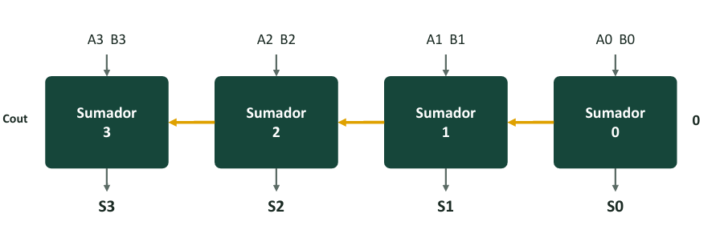

<!-- ===================== ENCABEZADO DE LA SEMANA ===================== -->

  

<blockquote>
  
🎯 <b>Mi Objetivo de Aprendizaje en esta Semana:</b> En las primeras tres semanas aprendí a representar números en binario, escribir tablas de verdad, simplificar ecuaciones mediante Mapas de Karnaugh e implementarlas con compuertas lógicas. En esta cuarta semana reúno todas esas herramientas para responder una pregunta apasionante: <b>¿cómo logra un circuito eléctrico sumar, restar y comparar números binarios?</b>

  
Al finalizar el estudio de esta guía soy capaz de:

  <ol>
    <li>Diseñar desde cero un <b>Semisumador (<i>Half Adder</i>)</b> y un <b>Sumador Completo (<i>Full Adder</i>)</b> aplicando el procedimiento clásico (tabla de verdad → Mapa de Karnaugh → circuito).</li>
    <li>Conectar varios sumadores en cascada para construir un <b>Sumador de 4 bits (<i>Ripple Carry Adder</i>)</b> y calcular cuántos nanosegundos tarda en entregar la respuesta final.</li>
    <li>Transformar el sumador en un <b>Sumador/Restador unificado</b> utilizando compuertas <b>XOR como inversores controlados</b> junto con el complemento a dos.</li>
    <li>Detectar por hardware cuándo ocurre un error de <b>desbordamiento (<i>overflow</i>)</b> con números con signo (V = C₃ ⊕ C₄), diseñar un <b>comparador de magnitud</b> y comprender cómo todos estos bloques forman la <b>ALU (Unidad Aritmético-Lógica)</b> de un procesador.</li>
  </ol>
</blockquote>

<h2>➕ 1. De la Suma en Papel al Diseño por Columnas</h2>

<h3>1.1. Sumar un solo bit: Los 4 casos posibles</h3>

Cuando sumamos dos números en el colegio, como 7 + 5 = 12, decimos mentalmente: <b>«escribo el <code>2</code> en mi columna y me llevo <code>1</code> a la columna siguiente»</b>.

En binario ocurre exactamente lo mismo, pero es mucho más sencillo porque al sumar dos bits (A y B) solo existen <b>4 combinaciones posibles</b>, las cuales generan dos salidas:

<ul>
  <li><b>S (<i>Sum</i> / Suma):</b> Es el bit que <b>escribo</b> debajo de la columna actual.</li>
  <li><b>C (<i>Carry</i> / Acarreo):</b> Es el bit que <b>me llevo</b> hacia la columna de la izquierda.</li>
</ul>

<table align="center" width="100%">
  <tr>
    <th>Operación Binaria</th>
    <th>Resultado en Decimal y Binario</th>
    <th>Escribo en la columna (S)</th>
    <th>Me llevo a la siguiente (C)</th>
  </tr>
  <tr align="center">
    <td><code>0 + 0</code></td>
    <td>0 = 00₂</td>
    <td><b><code>0</code></b></td>
    <td><b><code>0</code></b></td>
  </tr>
  <tr align="center">
    <td><code>0 + 1</code></td>
    <td>1 = 01₂</td>
    <td><b><code>1</code></b></td>
    <td><b><code>0</code></b></td>
  </tr>
  <tr align="center">
    <td><code>1 + 0</code></td>
    <td>1 = 01₂</td>
    <td><b><code>1</code></b></td>
    <td><b><code>0</code></b></td>
  </tr>
  <tr align="center">
    <td><code>1 + 1</code></td>
    <td>2 = 10₂</td>
    <td><b><code>0</code></b></td>
    <td><b><code>1</code></b></td>
  </tr>
</table>

<h3>1.2. Ejemplo de suma de 4 bits columna por columna: <code>0110</code> (6) + <code>0111</code> (7)</h3>

Observemos con lupa qué sucede en cada una de las 4 columnas (numeradas de derecha a izquierda como Columna 0, Columna 1, Columna 2 y Columna 3):

<pre><code>  Acarreo que llega (Cin):   1   1   0   0   ← En la Columna 0 nunca llega acarreo previo
                Número A:    0   1   1   0   ( 6 en decimal)
              + Número B:    0   1   1   1   ( 7 en decimal)
              ────────────────────────────
               Resultado:    1   1   0   1   (13 en decimal: 8 + 4 + 0 + 1 = 13 ✓)
              
              Posición:    Col3 Col2 Col1 Col0</code></pre>

<table align="center" width="100%">
  <tr>
    <th>Columna</th>
    <th>Operación realizada en esa columna</th>
    <th>Escribo (S)</th>
    <th>Llevo (Cout)</th>
    <th>Observación clave para el hardware</th>
  </tr>
  <tr>
    <td><b>Columna 0</b></td>
    <td><code>0 + 1 = 1</code></td>
    <td><code>1</code></td>
    <td><code>0</code></td>
    <td>Solo suma <b>2 bits</b> (A₀ y B₀); a su derecha no hay ninguna columna previa.</td>
  </tr>
  <tr>
    <td><b>Columna 1</b></td>
    <td><code>1 + 1 + 0 = 2</code> (10₂)</td>
    <td><code>0</code></td>
    <td><code>1</code></td>
    <td>Suma <b>3 bits</b> (A₁, B₁ y el acarreo <code>0</code> que llegó de la Columna 0).</td>
  </tr>
  <tr>
    <td><b>Columna 2</b></td>
    <td><code>1 + 1 + 1 = 3</code> (11₂)</td>
    <td><code>1</code></td>
    <td><code>1</code></td>
    <td>Suma <b>3 bits</b> (A₂, B₂ y el acarreo <code>1</code> que llegó de la Columna 1).</td>
  </tr>
  <tr>
    <td><b>Columna 3</b></td>
    <td><code>0 + 0 + 1 = 1</code> (01₂)</td>
    <td><code>1</code></td>
    <td><code>0</code></td>
    <td>Suma <b>3 bits</b> (A₃, B₃ y el acarreo <code>1</code> que llegó de la Columna 2).</td>
  </tr>
</table>

<blockquote>
  
💡 <b>El efecto dominó del acarreo:</b> Al sumar <code>0111</code> (7) + <code>0001</code> (1), el acarreo que nace en la Columna 0 provoca un nuevo acarreo en la Columna 1, este a su vez en la Columna 2 y llega hasta la Columna 3 para formar <code>1000</code> (8). Como los acarreos se encadenan, distinguimos <b>dos tipos de columnas</b>, que dan origen a <b>dos circuitos diferentes</b>: el <b>Semisumador</b> (para la Columna 0) y el <b>Sumador Completo</b> (para las Columnas 1, 2, 3…).

</blockquote>

<h2>🔧 2. El Semisumador (<i>Half Adder</i>): Para la Columna 0</h2>

El <b>Semisumador</b> es el circuito encargado de sumar únicamente <b>2 bits de entrada (A y B)</b> sin recibir ningún acarreo previo. Se llama <i>«semi»</i> precisamente porque no tiene entrada de acarreo (Cin) y solo sirve para la primera columna de la derecha (Columna 0).

<h3>2.1. Tabla de Verdad y Ecuaciones del Semisumador</h3>

<table align="center" width="100%">
  <tr>
    <th>Entrada A</th>
    <th>Entrada B</th>
    <th>Acarreo C (Me llevo)</th>
    <th>Suma S (Escribo)</th>
    <th>Análisis visual de las columnas de salida</th>
  </tr>
  <tr align="center">
    <td><code>0</code></td><td><code>0</code></td><td><code>0</code></td><td><code>0</code></td>
    <td align="left">Ambos son <code>0</code>.</td>
  </tr>
  <tr align="center">
    <td><code>0</code></td><td><code>1</code></td><td><code>0</code></td><td><b><code>1</code></b></td>
    <td align="left">A y B son distintos → S = 1.</td>
  </tr>
  <tr align="center">
    <td><code>1</code></td><td><code>0</code></td><td><code>0</code></td><td><b><code>1</code></b></td>
    <td align="left">A y B son distintos → S = 1.</td>
  </tr>
  <tr align="center">
    <td><code>1</code></td><td><code>1</code></td><td><b><code>1</code></b></td><td><code>0</code></td>
    <td align="left">Ambos son <code>1</code> → C = 1 y S = 0.</td>
  </tr>
</table>

Al comparar las dos columnas de salida con las 7 compuertas que estudiamos en la Semana 1, las reconocemos de inmediato sin siquiera hacer un mapa de Karnaugh:

<ul>
  <li><b>La columna de Suma (S)</b> vale <code>1</code> cuando A y B son distintos → es una compuerta <b>XOR</b>: <code>S = A ⊕ B</code></li>
  <li><b>La columna de Acarreo (C)</b> vale <code>1</code> solo cuando A y B son ambos <code>1</code> → es una compuerta <b>AND</b>: <code>C = A · B</code></li>
</ul>

<pre><code>   A ───┬──────► [ XOR ] ───► S = A ⊕ B  (Suma)
        │      ┌►[     ]
   B ───┼──────┘
        └──────► [ AND ] ───► C = A · B  (Acarreo)
               └►[     ]</code></pre>

<h2>⚙️ 3. El Sumador Completo (<i>Full Adder</i>): Para las Columnas 1, 2, 3…</h2>

A partir de la Columna 1, el circuito necesita sumar <b>3 bits al mismo tiempo</b>: el bit A, el bit B y el acarreo que llega de la columna anterior (Cin). A este bloque lo llamamos <b>Sumador Completo</b>.

<h3>3.1. El truco de «Contar Unos» para armar la Tabla de Verdad sin memorizar</h3>

Para llenar las 8 filas de la tabla de verdad del sumador completo sin equivocarme jamás, aplico este método práctico: <b>cuento cuántos unos hay en las tres entradas (A, B, Cin) de esa fila y escribo esa cantidad en binario de 2 bits (Cout S)</b>:

<ul>
  <li>Si hay <b>cero unos</b> → escribo <b><code>00</code></b> (Cout = 0, S = 0).</li>
  <li>Si hay <b>un solo uno</b> → escribo <b><code>01</code></b> (Cout = 0, S = 1).</li>
  <li>Si hay <b>dos unos</b> → escribo <b><code>10</code></b> (Cout = 1, S = 0).</li>
  <li>Si hay <b>tres unos</b> → escribo <b><code>11</code></b> (Cout = 1, S = 1).</li>
</ul>

<table align="center" width="100%">
  <tr>
    <th>Fila</th><th>A</th><th>B</th><th>Cin</th><th>Cantidad de <code>1</code> en la fila</th><th>En Binario (Cout S)</th><th>Acarreo de Salida (Cout)</th><th>Suma (S)</th>
  </tr>
  <tr align="center"><td><b>0</b></td><td>0</td><td>0</td><td>0</td><td>0 unos</td><td><code>00</code></td><td><code>0</code></td><td><code>0</code></td></tr>
  <tr align="center"><td><b>1</b></td><td>0</td><td>0</td><td>1</td><td>1 uno</td><td><code>01</code></td><td><code>0</code></td><td><b><code>1</code></b></td></tr>
  <tr align="center"><td><b>2</b></td><td>0</td><td>1</td><td>0</td><td>1 uno</td><td><code>01</code></td><td><code>0</code></td><td><b><code>1</code></b></td></tr>
  <tr align="center"><td><b>3</b></td><td>0</td><td>1</td><td>1</td><td>2 unos</td><td><code>10</code></td><td><b><code>1</code></b></td><td><code>0</code></td></tr>
  <tr align="center"><td><b>4</b></td><td>1</td><td>0</td><td>0</td><td>1 uno</td><td><code>01</code></td><td><code>0</code></td><td><b><code>1</code></b></td></tr>
  <tr align="center"><td><b>5</b></td><td>1</td><td>0</td><td>1</td><td>2 unos</td><td><code>10</code></td><td><b><code>1</code></b></td><td><code>0</code></td></tr>
  <tr align="center"><td><b>6</b></td><td>1</td><td>1</td><td>0</td><td>2 unos</td><td><code>10</code></td><td><b><code>1</code></b></td><td><code>0</code></td></tr>
  <tr align="center"><td><b>7</b></td><td>1</td><td>1</td><td>1</td><td>3 unos</td><td><code>11</code></td><td><b><code>1</code></b></td><td><b><code>1</code></b></td></tr>
</table>

<blockquote>
  
🧠 <b>Regla verbal para recordar toda la vida:</b>

  <ul>
    <li><b>S = 1</b> cuando en la entrada hay un <b>número IMPAR de unos</b> (1 o 3 unos).</li>
    <li><b>Cout = 1</b> cuando en la entrada hay <b>AL MENOS DOS unos</b> (es exactamente la misma función de mayoría que nuestra alarma de 3 sensores de la Semana 2).</li>
  </ul>
</blockquote>

<h3>3.2. Obtención de las Ecuaciones con Mapas de Karnaugh</h3>

<h4>A) Mapa de Karnaugh para la Suma (S): El patrón «Tablero de Ajedrez»</h4>
<table align="center" width="60%">
  <tr><th>A \ BCin</th><th><code>00</code></th><th><code>01</code></th><th><code>11</code></th><th><code>10</code></th></tr>
  <tr align="center"><td><b><code>0</code></b></td><td><code>0</code></td><td><b><code>1</code></b></td><td><code>0</code></td><td><b><code>1</code></b></td></tr>
  <tr align="center"><td><b><code>1</code></b></td><td><b><code>1</code></b></td><td><code>0</code></td><td><b><code>1</code></b></td><td><code>0</code></td></tr>
</table>
<ul>
  <li><b>Diagnóstico:</b> Los unos quedan alternados en diagonal como un tablero de ajedrez; ningún <code>1</code> tiene un vecino horizontal ni vertical. Siempre que en un K-map aparece el tablero de ajedrez, significa que la función es una <b>XOR encadenada de todas las variables</b>: <code>S = A ⊕ B ⊕ Cin</code></li>
</ul>

<h4>B) Mapa de Karnaugh para el Acarreo de Salida (Cout): Tres grupos de dos</h4>
<table align="center" width="60%">
  <tr><th>A \ BCin</th><th><code>00</code></th><th><code>01</code></th><th><code>11</code></th><th><code>10</code></th></tr>
  <tr align="center"><td><b><code>0</code></b></td><td><code>0</code></td><td><code>0</code></td><td><b><code>1</code></b> (m₃)</td><td><code>0</code></td></tr>
  <tr align="center"><td><b><code>1</code></b></td><td><code>0</code></td><td><b><code>1</code></b> (m₅)</td><td><b><code>1</code></b> (m₇)</td><td><b><code>1</code></b> (m₆)</td></tr>
</table>
<ul>
  <li><b>Agrupaciones:</b>
    <ol>
      <li>Par vertical en la columna <code>11</code> (m₃, m₇) → <code>B · Cin</code></li>
      <li>Par horizontal derecho en la fila A=1 (m₇, m₆) → <code>A · B</code></li>
      <li>Par horizontal izquierdo en la fila A=1 (m₅, m₇) → <code>A · Cin</code></li>
    </ol>
  </li>
  <li><b>Ecuación mínima de acarreo:</b> <code>Cout = AB + A · Cin + B · Cin</code></li>
</ul>

<h2>🌊 4. Sumador de 4 Bits en Cadena (<i>Ripple Carry</i>) y Estimación del Retardo</h2>

<h3>4.1. Cómo conectar 4 sumadores completos en cascada</h3>

Para sumar dos números de 4 bits (A₃ A₂ A₁ A₀ + B₃ B₂ B₁ B₀), colocamos <b>cuatro sumadores en fila</b> siguiendo una regla única:

<blockquote>
  
<b>Regla de conexión en cascada:</b> El acarreo que sale de una etapa (<b>Cout</b>) se conecta directamente al acarreo que entra en la etapa siguiente (<b>Cin</b>), poniendo Cin = 0 en el Sumador 0.

</blockquote>

  

<h3>4.2. ¿Por qué se llama <i>Ripple Carry</i> (Acarreo en Ola) y cuánto tarda?</h3>

En el mundo físico las compuertas tardan unos cuantos nanosegundos (ns) en conmutar:

<ul>
  <li>Cada compuerta tarda ≈ 10 ns.</li>
  <li>El acarreo cruza ≈ 2 compuertas por etapa (20 ns/bit).</li>
  <li>Para n bits: <b>Retardo ≈ 2 · n · 10 ns</b>.
    <ul>
      <li><b>4 bits:</b> 80 ns</li>
      <li><b>16 bits:</b> 320 ns</li>
      <li><b>32 bits:</b> 640 ns</li>
    </ul>
  </li>
</ul>

<h2>➖ 5. Sumador/Restador Unificado y Detección de <i>Overflow</i></h2>

<h3>5.1. La compuerta XOR como «Inversor Controlado»</h3>

Restar es sumar el negativo en complemento a dos (A - B = A + B' + 1).

Usamos una compuerta <b>XOR en cada bit de B</b> controlada por el modo M:

<ul>
  <li><b>M = 0 (Suma):</b> B ⊕ 0 = B y Cin = 0 → <b>A + B</b>.</li>
  <li><b>M = 1 (Resta):</b> B ⊕ 1 = B' y Cin = 1 → <b>A + B' + 1 = A - B</b>.</li>
</ul>

<h3>5.2. Detección de <i>Overflow</i> por Hardware</h3>

En 4 bits con signo el rango es de -8 a +7. Ocurre overflow si el acarreo que entra a la última etapa (C₃) difiere del que sale (C₄):

<b>V = C₃ ⊕ C₄</b>

<i>(Recordatorio: Cout = 1 NO significa error).</i>

<h2>⚖️ 6. Comparador de Magnitud y Arquitectura de la ALU</h2>

<ul>
  <li><b>Igualdad (A = B):</b> Compuertas <b>XNOR</b> en cada bit (dan <code>1</code> si son iguales) y una compuerta <b>AND</b> final.</li>
  <li><b>Mayor que (A > B):</b> Se evalúa de izquierda a derecha. En 2 bits: <b>A₁ B₁' + (A₁ ⊕ B₁)' A₀ B₀'</b>.</li>
  <li><b>La ALU (Unidad Aritmético-Lógica):</b> Sumador/Restador, Comparador y compuertas lógicas operan en paralelo; un <b>Multiplexor</b> selecciona el resultado final.</li>
</ul>

<h2>🛠️ 7. Resolución del Taller Dirigido en Parejas</h2>

<ol>
  <li><b>Sumar <code>1011</code> + <code>0110</code>:</b> 
      A = 11 (decimal), B = 6 (decimal). Acarreos: C₃ = 1, C₂ = 1, C₁ = 1, C₀ = 0. 
      Salida: S = <b><code>0001</code></b> con Cout = <b><code>1</code></b> (resultado 10001₂ = 17 en decimal ✓).</li>
  <li><b>Restar <code>0110</code> - <code>0011</code> con M=1:</b> 
      B = 0011 → B' = 1100, con Cin = 1. 
      Suma columna por columna: S = <b><code>0011</code></b> (+3 en decimal ✓), Cout = 1 (se descarta) y V = 1 ⊕ 1 = 0.</li>
  <li><b>Retardo de un sumador de 16 bits:</b> 
      2 × 16 = 32 compuertas × 10 ns = <b>320 ns</b>.</li>
  <li><b>Comparar A = 10₂ y B = 01₂:</b> 
      Bit alto: A₁ = 1, B₁ = 0. Como A₁ > B₁, <b>A > B = 1</b> y <b>A = B = 0</b>.</li>
</ol>

<table align="center" width="100%">
  <tr>
    <td align="left"><a href="Semana_3.md">⬅️ Semana 3</a></td>
    <td align="right"><a href="README.md">🏠 Inicio</a></td>
  </tr>
</table>
